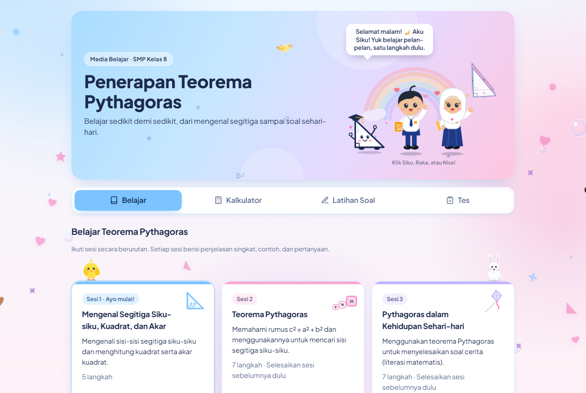

# Penerapan Teorema Pythagoras

Media pembelajaran berbasis web untuk **membangun literasi matematis** siswa SMP pada materi teorema Pythagoras. Berisi materi belajar 3 sesi, kalkulator dengan langkah penyelesaian, dan latihan soal kontekstual.

Dibuat untuk memenuhi **Project UAS** mata kuliah **Algoritma Pemrograman**.

| | |
| --- | --- |
| Nama | Azkiah Safira |
| NIM | 2225250013 |
| Kelas | 3F |
| Dosen Pengampu | Dr. Aan Hendrayana, S.Si., M.Pd. |

<p align="center">
  <a href="https://azkiahsafira.github.io/project-uas-penerapan-pythagoras-2225250013/"><strong>🚀 Buka aplikasinya di sini</strong></a><br>
  <sub>https://azkiahsafira.github.io/project-uas-penerapan-pythagoras-2225250013/</sub>
</p>

<p align="center">
  <a href="https://azkiahsafira.github.io/project-uas-penerapan-pythagoras-2225250013/">
    
  </a>
</p>

> Halaman repository ini hanya berisi kode. Warna, animasi, dan karakter aplikasinya terlihat di link di atas (GitHub Pages).

## Dokumen Perancangan (revisi dosen)

Dokumen perancangan versi 2, disusun dari hasil wawancara kebutuhan siswa (tahap *Analysis* ADDIE):

| Dokumen | Isi |
| --- | --- |
| [prd.md](prd.md) | Kebutuhan produk: tujuan literasi matematis, temuan wawancara → fitur, MVP |
| [architecture.md](architecture.md) | Arsitektur: React + three.js (JavaScript), FastAPI (Python) di Vercel, Supabase |
| [design.md](design.md) | Desain antarmuka Android, Mode Fokus, warna bermakna, petunjuk bertingkat, 3D |
| [api.md](api.md) | Rancangan API backend: masuk dengan kode siswa, hasil, aktivitas, rekap peneliti |
| [task.md](task.md) | Daftar tugas per tahap ADDIE + wawancara kebutuhan Android |
| [agents.md](agents.md) | Aturan untuk AI agent/asisten koding di proyek ini |
| [konten.md](konten.md) | Spesifikasi isi: bab & subbab, tujuan, indikator literasi matematis, aturan menulis soal |
| [testing.md](testing.md) | Rencana pengujian: otomatis, fungsional, perangkat Android, validasi ahli, uji coba |
| [deploy.md](deploy.md) | Pemasangan & pemeliharaan: GitHub Pages, Supabase, Vercel, checklist sebelum penelitian, cadangan data |
| [privasi.md](privasi.md) | Etika penelitian & perlindungan data siswa (persetujuan, kode siswa, penyimpanan) |
| [panduan.md](panduan.md) | Panduan penggunaan untuk siswa dan peneliti/guru, plus solusi masalah umum |
| [changelog.md](changelog.md) | Riwayat perubahan aplikasi per versi |
| [Materi ajar (PDF)](docs/materi/Materi-Teorema-Pythagoras.pdf) | Bab Teorema Pythagoras, subbab *Penerapan Teorema Pythagoras dalam Menyelesaikan Masalah* (11 halaman), disusun dari temuan wawancara (dibuat dengan `python scripts/buat_materi.py`) |

## Install sebagai Aplikasi (Android, Windows, iPhone)

Aplikasi ini adalah **PWA (Progressive Web App)**: bisa dipasang seperti aplikasi biasa (punya ikon sendiri) dan **tetap bisa dibuka tanpa internet** setelah dibuka sekali.

| Perangkat | Cara install |
| --------- | ------------ |
| **Android** (Chrome) | Buka link aplikasi → ketuk tombol **📲 Install aplikasi** di header, atau menu ⋮ → **Instal aplikasi / Tambahkan ke layar utama** |
| **Windows / Laptop** (Chrome atau Edge) | Buka link aplikasi → klik **📲 Install aplikasi**, atau ikon install di ujung kanan kolom alamat |
| **iPhone / iPad** (Safari) | Buka link aplikasi → ketuk **Bagikan** (kotak dengan panah ke atas) → **Tambah ke Layar Utama** |

Saat offline, materi, kalkulator, latihan, dan tes tetap bisa dipakai. Hasil tes disimpan di perangkat dan **dikirim otomatis ke Supabase** begitu internet kembali.

## Teorema Pythagoras

Pada segitiga siku-siku, kuadrat sisi miring sama dengan jumlah kuadrat kedua sisi siku-sikunya:

```
c² = a² + b²
```

| Simbol | Keterangan |
| ------ | ---------- |
| `a` | alas (sisi siku-siku mendatar) |
| `b` | tinggi (sisi siku-siku tegak) |
| `c` | sisi miring (hipotenusa), selalu sisi terpanjang |

Dari rumus tersebut diperoleh tiga bentuk:

| Yang dicari | Rumus |
| ----------- | ----- |
| Sisi miring | `c = √(a² + b²)` |
| Alas | `a = √(c² − b²)` |
| Tinggi | `b = √(c² − a²)` |

## Fitur

- **Belajar 3 sesi**: materi bertahap yang harus diikuti berurutan.
  - Urutan & contoh sama dengan [materi PDF](docs/materi/Materi-Teorema-Pythagoras.pdf).
  - Sesi 1 (PDF Bagian 1–2): kuadrat, akar kuadrat, tabel kuadrat, segitiga siku-siku, dan sisi miring pada segitiga yang diputar.
  - Sesi 2 (PDF Bagian 3): pola luas 9 + 16 = 25, teorema Pythagoras, dan memilih rumus (tambah/kurang).
  - Sesi 3 (PDF Bagian 4–5): Strategi 5 Langkah, panjang tangga, tinggi layang-layang, jarak terpendek, diagonal layar, tripel Pythagoras, refleksi.
  - Tombol **🔊 Bacakan** membacakan judul, penjelasan, rumus (simbol dibaca sebagai kata, misalnya “c kuadrat sama dengan…”), dan pertanyaan; bagian yang sedang dibacakan disorot seperti stabilo. Soal di Latihan juga bisa dibacakan. Memakai suara bawaan perangkat (Web Speech API), gratis.
  - Setiap langkah punya cek pemahaman: petunjuk muncul jika salah, dan jawaban dibuka setelah 2 kali salah agar siswa tidak buntu. Progres sesi tersimpan di perangkat.
- **Fitur dari temuan wawancara** (lihat [prd.md](prd.md) §5):
  - **Cek prasyarat** (kartu "Pemanasan" di menu Belajar): 4 soal kuadrat & akar kuadrat sebelum Sesi 1; bila benar < 3, siswa diarahkan ke bagian kuadrat & akar di Sesi 1 (IL3).
  - **Diketahui & Ditanya** (Latihan langkah 1): siswa mengetuk angka di soal cerita, menentukan sisi siku-siku/sisi miring, dan apa yang ditanya; ringkasannya tetap tampil saat menghitung (EL1).
  - **Tunjuk sisi miring** (langkah 2): segitiga digambar dalam posisi diputar/dicerminkan; siswa mengetuk sisi di depan tanda sudut siku-siku (IL1).
  - **Petunjuk bertingkat 5 tahap** (cari segitiga siku-siku → sisi miring → rumus → hitung → cek) yang **memudar**: setelah 3 soal benar tanpa bantuan, langkah 1–2 disembunyikan dan petunjuk tinggal 3 tahap; muncul lagi bila siswa salah (GL3).
  - **Cek kewajaran**: jawaban yang mustahil (mis. sisi miring lebih pendek) tidak langsung dinilai; siswa diajak memeriksa dulu (GL2).
  - **Refleksi "Mengapa…?"** setiap soal ke-3, dengan alasan tertulis opsional (GL4).
- **Tes penelitian** (menu Tes):
  - **Pre-test** (pertemuan 1, sebelum Sesi 1) dan **post-test** (pertemuan 5): masing-masing 10 soal paralel, satu soal per layar, tanpa umpan balik benar/salah agar tes tidak ikut mengajari.
  - **Kuesioner beban kognitif Leppink** (pertemuan 5, setelah post-test): 10 pernyataan skala 0–10 untuk intrinsic, extraneous, dan germane load.
  - Identitas siswa (nama, kelas, sekolah, kelompok: belajar dengan aplikasi), durasi pengerjaan, dan nilai dicatat. Menu lain disembunyikan selama tes.
  - Hasil disimpan di perangkat lalu dikirim ke database **Supabase**. Jika internet putus, hasil tetap aman di perangkat dan dikirim ulang otomatis. Hasil juga bisa diunduh sebagai CSV.
- **Kalkulator tiga mode**: mencari sisi miring, alas, atau tinggi.
- **Langkah penyelesaian**: perhitungan ditampilkan baris per baris, dari rumus sampai hasil akhir.
- **Gambar segitiga**: ukuran segitiga menyesuaikan input, dan sisi yang dicari diberi warna.
- **Deteksi tripel Pythagoras**: memberi tahu jika ketiga sisi bilangan bulat, misalnya (3, 4, 5).
- **Validasi input**: menolak angka kosong, nol, negatif, atau sisi miring yang tidak lebih panjang dari sisi lain.
- **Contoh soal sehari-hari** (Kalkulator, sama dengan Contoh 1–3 materi PDF): panjang tangga, tinggi layang-layang, jarak terpendek, dan diagonal layar.
- **Latihan soal = Pertemuan 4 (implementasi)**: berjenjang seperti Latihan Berjenjang materi PDF: soal 1–3 angka langsung, soal 4–6 dengan gambar yang diputar, soal 7 dst. soal cerita (tangga, layang-layang, jarak berjalan, perahu, diagonal layar, kawat tiang bendera, diagonal taman); angka dibuat acak dari tripel Pythagoras yang tidak dipakai di pre/post-test, jawaban diperiksa otomatis, ada skor, target minimal 10 soal dengan progress bar, dan pembahasan langkah demi langkah ditampilkan setelah menjawab. Setiap soal yang dijawab dicatat ke database (benar/salah/lihat jawaban, lama waktu, pemakaian Bacakan).
- **Header beranimasi**: prisma segitiga 3-4-5 yang berputar dalam 3D (CSS 3D transform), dua siswa SMP bergaya chibi (Raka dan Nisa yang berjilbab) yang melambai dan sesekali melompat, pelangi pastel, simbol matematika yang melayang, serta awan berwajah.
- **Karakter interaktif**: klik Siku untuk mendengar sorakan penyemangat (dengan konfeti), klik Raka atau Nisa untuk disapa, dan elus 8 hewan yang tersebar di halaman: anak ayam & kelinci hinggap di kartu sesi, anjing di kartu kalkulator, kucing di samping judul contoh soal, katak di kartu latihan, panda & beruang mengintip dari pinggir layar (layar lebar), dan bebek yang sesekali berjalan melintas di bawah layar. Setiap karakter dan hewan punya beberapa kalimat yang bergantian, dan balon kata di header berganti sendiri sesuai menu (diawali salam sesuai jam). Ada juga burung yang terbang melintas di header dan ilustrasi beranimasi di tiap kartu sesi.
- **Halaman sekolah di header**: Raka, Nisa, dan Siku berdiri di rumput halaman sekolah (tidak melayang), di depan gedung SMP dengan bendera merah putih yang berkibar, jam menara yang berputar, siswa yang muncul dan melambai dari jendela, pohon yang bergoyang, serta bus sekolah yang lewat di jalan. Latar halaman juga dihiasi kupu-kupu yang terbang, balon tersenyum yang naik, pesawat kertas, dan awan tersenyum. Semuanya disembunyikan saat tes dan berhenti bila animasi dimatikan.
- **Latar belakang “Bawah Laut” di semua menu**: gurita besar yang menulis 3² + 4² = 5² di papan kecil, paus yang menyemburkan air, Siku si ikan segitiga siku-siku dan kura-kura yang berenang melintas bersama gerombolan ikan kecil, rumput laut yang bergoyang, bintang laut, kerang, pasir, cahaya matahari yang menembus air, dan gelembung yang naik. Kotak-kotak di bawah header dibuat tembus pandang sehingga latar tetap terlihat saat digulir; header tetap padat. Disembunyikan saat tes berlangsung.
- **Musik latar ceria** (tombol 🎵 di pojok kanan bawah): lagu ciptaan sendiri yang dimainkan langsung dengan Web Audio (tanpa file, bebas hak cipta), bernada marimba dengan bass lembut. Bawaannya mati; pilihan disimpan. Musik otomatis mengecil saat fitur Bacakan berbicara, berhenti saat tes, dan berhenti saat aplikasi tidak sedang dibuka.
- **Pesan semangat saat jawaban salah**: Siku muncul kecil di bawah layar sambil melambai dengan kalimat penyemangat (misalnya “Hampir! Coba lagi ya 💪” atau “Tidak apa-apa! Baca pembahasannya ya 📖”), tanpa suara dan tanpa menutupi soal, agar siswa tidak patah semangat.
- **Hewan laut bisa diklik**: paus menyemburkan air, gurita melambaikan tentakel, ikan segitiga bersalto, gerombolan ikan berpencar, bintang laut berputar, kerang memunculkan mutiara; masing-masing dengan balon kata lucu. Klik di area kosong diteruskan ke latar, sedangkan kotak, tombol, dan isian tetap bisa dipakai seperti biasa.
- **Layar perayaan penuh saat jawaban benar** (menu Belajar dan Latihan): tulisan besar acak seperti “HEBAT!” atau “LUAR BIASA!”, hujan konfeti satu layar, tangan bertepuk 👏, Siku menari, dan suara “ta-da” + tepuk tangan yang dibuat langsung dengan Web Audio (tanpa file suara). Tampil ±2 detik lalu hilang sendiri (atau klik untuk langsung lanjut) agar siswa cepat kembali ke penjelasan. Suara bisa dimatikan lewat tombol “👏 Suara tepuk tangan” di bagian bawah halaman. Tidak pernah muncul di menu Tes.
- **Animasi penyemangat**: konfeti saat jawaban benar, layar perayaan saat satu sesi selesai (pelangi dan Siku bertopi wisuda yang menari), Siku mini yang berjalan di progress bar, umpan balik salah yang bergoyang pelan, combo 🔥 saat benar berturut-turut di Latihan Soal, segitiga kalkulator yang tergambar garis demi garis, dan transisi halaman.
- **Tombol "Animasi: nyala/mati"** di bagian bawah halaman, misalnya untuk siswa yang mudah terganggu. Semua animasi juga berhenti selama tes.
- **Maskot "Siku"**: karakter segitiga siku-siku beranimasi (melayang, berkedip, melambai) dengan balon kata di header, serta bereaksi senang/berpikir saat siswa menjawab. Animasi berhenti saat tes dan mengikuti pengaturan *kurangi gerakan* perangkat.
- **Latar halaman beranimasi**: gumpalan warna biru–pink yang bergerak lembut, gelembung sabun yang melayang lalu pecah, bentuk kecil (segitiga, hati, bintang, lingkaran, plus) yang melayang naik, dan bintang berkelip di area kosong halaman.
- **Efek lucu lainnya**: hati & bintang meletup di setiap klik/sentuhan, jejak kilau di belakang kursor (laptop), mata Siku dan Raka yang melirik mengikuti kursor, Siku yang tertidur (Zzz) bila halaman lama tidak disentuh, dan tombol sesi berikutnya yang berdenyut.
- Tema biru muda (baby blue) + pink pastel, responsif (laptop dan HP), serta mendukung mode terang/gelap.

## Rancangan Berdasarkan Teori Beban Kognitif

Materi di [src/materi.js](src/materi.js) dirancang mengikuti *Cognitive Load Theory* (Activation/Balance Model):

| Beban | Strategi | Penerapan di aplikasi |
| ----- | -------- | --------------------- |
| Intrinsic load | Dikelola | Materi dipecah jadi langkah kecil (satu konsep per layar); prasyarat kuadrat dan akar diajarkan dulu di Sesi 1; sesi berikutnya terkunci sampai sesi sebelumnya selesai. |
| Extraneous load | Ditekan | Satu layar hanya berisi teks singkat, satu gambar, dan satu pertanyaan; tanpa animasi atau hiasan; di HP gambar ditaruh di atas teks agar tidak perlu scroll bolak-balik (*split-attention*); tombol **Bacakan** menyajikan penjelasan secara lisan sementara mata fokus pada gambar (*prinsip modalitas*). |
| Germane load | Dioptimalkan | Contoh lengkap (*worked example*) diikuti contoh setengah jadi (*faded example*); cek pemahaman dengan umpan balik dan petunjuk di setiap langkah; Strategi 5 Langkah untuk soal cerita; refleksi di akhir. |

## Alur Penelitian

| Pertemuan | Kegiatan | Menu di aplikasi |
| --------- | -------- | ---------------- |
| 1 | Pre-test, lalu Sesi 1 | Tes → Pre-test, lalu Belajar → Sesi 1 |
| 2 | Sesi 2 | Belajar → Sesi 2 |
| 3 | Sesi 3 | Belajar → Sesi 3 |
| 4 | Implementasi (difasilitasi mahasiswa) | Latihan Soal (label "Pertemuan 4 · Implementasi", minimal 10 soal), Kalkulator untuk memeriksa |
| 5 | Post-test dan skala beban kognitif | Tes → Post-test, lalu Tes → Kuesioner Beban Kognitif |

Siswa yang belajar dengan aplikasi mengerjakan pre-test, post-test, dan kuesioner di menu Tes (tercatat sebagai kelompok "Belajar dengan aplikasi"). Siswa yang diajar langsung mengerjakan **lembar cetak** yang soalnya sama persis ([docs/instrumen-cetak](docs/instrumen-cetak): pre-test, post-test, kuesioner, dan kunci jawaban, dibuat otomatis dari `src/tes.js` dengan `node scripts/buat-lembar-tes.mjs`); jawabannya dimasukkan ke analisis lewat `analisis/templat_kertas.csv`.

### Instrumen

- **Pre-test dan post-test** ([src/tes.js](src/tes.js)): 10 soal paralel. Setiap nomor mengukur indikator yang sama dengan angka/konteks berbeda:

  | No | Indikator |
  | -- | --------- |
  | 1 | Mengenali sisi miring segitiga siku-siku |
  | 2 | Menghitung kuadrat bilangan |
  | 3 | Menghitung akar kuadrat |
  | 4 | Menentukan bentuk rumus Pythagoras |
  | 5 | Menghitung sisi miring |
  | 6 | Menghitung sisi siku-siku |
  | 7 | Soal cerita: mencari sisi siku-siku |
  | 8 | Soal cerita: mencari sisi miring (jarak) |
  | 9 | Menentukan tripel Pythagoras |
  | 10 | Soal cerita: diagonal layar |

  Nilai = jumlah benar ÷ 10 × 100.

- **Kuesioner beban kognitif**: diadaptasi dari Leppink dkk. (2013), 10 butir skala 0 (sama sekali tidak setuju) sampai 10 (sangat setuju). Skor tiap jenis beban adalah rata-rata butirnya:

  | Jenis beban | Butir | Harapan |
  | ----------- | ----- | ------- |
  | Intrinsic load (IL) | 1–3 | dikelola |
  | Extraneous load (EL) | 4–6 | serendah mungkin |
  | Germane load (GL) | 7–10 | setinggi mungkin |

## Algoritma

Algoritma perhitungan ada di fungsi `hitung()` pada [src/pythagoras.js](src/pythagoras.js).

```
MULAI
  BACA sisi yang dicari (a, b, atau c)
  BACA dua sisi yang diketahui

  UNTUK setiap sisi yang diketahui:
    JIKA bukan angka ATAU ≤ 0 MAKA
      TAMPILKAN "harus berupa angka lebih dari 0"
      SELESAI

  JIKA yang dicari = c MAKA
    c ← √(a² + b²)
  SELAIN ITU
    JIKA c ≤ sisi lain MAKA
      TAMPILKAN "sisi miring harus lebih panjang"
      SELESAI
    sisi yang dicari ← √(c² − sisi lain²)

  TAMPILKAN hasil (dibulatkan 2 angka di belakang koma)
  TAMPILKAN langkah-langkah perhitungan
  JIKA a, b, c semuanya bilangan bulat MAKA
    TAMPILKAN "tripel Pythagoras"
SELESAI
```

### Contoh

Tangga sepanjang 5 m bersandar di dinding, jarak kaki tangga ke dinding 3 m. Berapa tinggi dinding yang dicapai?

```
b² = c² − a²
b² = 5² − 3²
b² = 25 − 9
b² = 16
b  = √16 = 4 m
```

### Algoritma Latihan Soal

Ada di [src/Latihan.jsx](src/Latihan.jsx). Soal dibuat dari daftar *tripel Pythagoras* (misalnya 3-4-5, 5-12-13, 8-15-17) supaya jawabannya selalu bilangan bulat.

```
MULAI
  skor ← 0, total ← 0
  ULANGI
    pilih acak satu tripel (a, b, c)
    pilih acak sisi yang dicari (a, b, atau c)
    pilih acak cerita soal yang sesuai, tidak sama dengan soal sebelumnya
    pilih acak posisi segitiga (diputar 0–320°, boleh dicerminkan)
    JIKA lancar < 3 MAKA                     // bantuan penuh
      langkah 1: siswa mengetuk angka & mengisi Diketahui/Ditanya (2× salah → jawaban dibuka)
      langkah 2: siswa mengetuk sisi miring pada segitiga yang diputar
    TAMPILKAN gambar dengan label (sisi yang dicari ditulis "?")

    BACA jawaban (boleh membuka petunjuk 1..5, atau 1..3 bila lancar)
    JIKA jawaban tidak wajar (sisi miring tidak terpanjang) MAKA
      TAMPILKAN peringatan cek kewajaran; siswa boleh memperbaiki
    total ← total + 1
    JIKA |jawaban − kunci| < 0,01 MAKA
      skor ← skor + 1
      TAMPILKAN "Benar!"
      JIKA tanpa petunjuk & tanpa salah langkah MAKA lancar ← lancar + 1 SELAIN ITU lancar ← 0
    SELAIN ITU
      TAMPILKAN "Belum tepat" dan kunci jawaban; lancar ← 0
    TAMPILKAN pembahasan (memakai fungsi hitung()) + kalimat cek kewajaran
    JIKA total habis dibagi 3 MAKA TAMPILKAN pertanyaan refleksi "Mengapa…?"
  SAMPAI pengguna berhenti
SELESAI
```

## Teknologi

- **JavaScript + framework [React](https://react.dev) 19**: antarmuka pengguna
- [Vite](https://vite.dev) 8: server pengembangan dan build
- [three.js](https://threejs.org) 0.180: ilustrasi 3D tangga–dinding (diunduh hanya saat dibuka)
- **Python + framework [FastAPI](https://fastapi.tiangolo.com)**: backend API (masuk dengan kode siswa, penilaian tes di server) — folder [backend](backend)
- [Oxlint](https://oxc.rs): pemeriksa kode (linter)
- [Supabase](https://supabase.com): database penyimpanan hasil penelitian
- PWA (manifest + service worker): bisa di-install dan dipakai offline
- [Python](https://www.python.org) 3: analisis data penelitian

## Database (Supabase)

Ada dua tabel. Skema dan aturan keamanannya ada di [supabase/schema.sql](supabase/schema.sql).

| Tabel | Isi |
| ----- | --- |
| `hasil` | pre-test, post-test, dan kuesioner Leppink (nilai, jawaban, durasi, IL/EL/GL) |
| `aktivitas` | proses belajar di menu Belajar: tiap **langkah** (lama waktu, berapa kali salah, hasil pertanyaan: benar / jawaban dibuka, berapa kali tombol Bacakan dipakai) dan tiap **sesi** (total waktu, total salah, selesai / keluar di tengah); serta tiap soal **latihan** pertemuan 4 (`sesi` = 4, `langkah` = nomor soal, hasil benar / salah / menyerah) |

Sebelum mulai Sesi 1, siswa mengisi nama sekali ("Kenalan dulu, yuk!"); nama yang sama dipakai juga di menu Tes.

- Aplikasi hanya boleh **menambah** data (Row Level Security). Membaca, mengubah, dan menghapus data hanya bisa dilakukan peneliti lewat dashboard Supabase, sehingga nama dan nilai siswa tidak bisa dilihat orang lain.
- Data untuk dianalisis: Supabase → **Table Editor** → tabel `hasil` (dan `aktivitas`) → **Export to CSV**.

Proyek Supabase: **penelitian-pythagoras** (region Singapore). URL dan *publishable key*-nya ada di file [.env](.env) dan ikut dipakai saat build di GitHub Actions. Publishable key memang aman dibagikan karena tabel dilindungi RLS; **jangan pernah** menaruh *secret key* di repo.

**Agar proyek tidak dijeda:** Supabase paket gratis menjeda proyek yang 7 hari tanpa aktivitas (data tetap aman, bisa dipulihkan dengan **Restore project** di dashboard). Workflow [.github/workflows/supabase-aktif.yml](.github/workflows/supabase-aktif.yml) otomatis "menyapa" database setiap 3 hari supaya proyek tetap aktif; bila gagal, GitHub mengirim email pemberitahuan. Workflow ini bisa juga dijalankan manual dari tab **Actions** → **Jaga Supabase tetap aktif** → **Run workflow**. Catatan: GitHub menonaktifkan jadwal otomatis bila repo tidak ada commit selama 60 hari; aktifkan lagi dari tab Actions bila muncul pemberitahuan.

**Cadangan:** setelah setiap pertemuan penelitian, unduh tabel `hasil` dan `aktivitas` (Table Editor → Export to CSV) dan simpan di laptop/Google Drive.

Jika ingin memakai proyek Supabase lain: jalankan `supabase/schema.sql` di **SQL Editor** proyek tersebut, lalu ganti isi `.env` dengan **Project URL** dan **publishable key** dari **Project Settings → API Keys**.

## Cara Menjalankan

Pastikan [Node.js](https://nodejs.org) sudah terpasang, lalu jalankan di folder ini:

```bash
npm install
npm run dev
```

Buka alamat yang muncul di terminal (biasanya http://localhost:5173).

Perintah lainnya:

| Perintah | Fungsi |
| -------- | ------ |
| `npm run build` | membuat versi siap pakai di folder `dist` |
| `npm run preview` | menjalankan hasil build |
| `npm run lint` | memeriksa kode |

Setiap push ke branch `main` otomatis di-build dan di-deploy ke GitHub Pages lewat GitHub Actions ([.github/workflows/deploy.yml](.github/workflows/deploy.yml)).

### Backend Python (FastAPI)

```bash
python -m venv backend/.venv
backend/.venv/Scripts/python -m pip install -r backend/requirements.txt   # Windows
backend/.venv/Scripts/python -m pytest backend -q                         # 15 pengujian
backend/.venv/Scripts/python -m uvicorn backend.main:app --reload         # http://127.0.0.1:8000/docs
```

Tanpa variabel `SUPABASE_URL`/`SUPABASE_SERVICE_KEY`, backend menyimpan data di memori (aman untuk mencoba; kode contoh `8A-01`, `8A-02`).
Untuk menyambungkan aplikasi ke backend, isi `VITE_API_URL` di `.env` (mis. `http://127.0.0.1:8000`). Bila kosong, aplikasi memakai cara lama
(langsung ke Supabase). Backend sudah aktif di **Vercel**: https://pythagoras-api.vercel.app/api/sehat. Cara memasangnya ada di [deploy.md](deploy.md).

## Analisis Data (Python)

Script [analisis/analisis.py](analisis/analisis.py) mengolah CSV ekspor tabel `hasil` dari Supabase: nilai pre/post-test, N-gain, ketercapaian indikator, skor beban kognitif Leppink, perbandingan kelompok, serta grafik SVG. Dengan opsi `--aktivitas`, script juga menganalisis tabel `aktivitas`: rata-rata waktu dan jumlah salah tiap langkah materi, waktu tiap sesi, langkah yang paling lama/paling banyak salah (indikasi intrinsic load), serta rekap latihan pertemuan 4 per siswa (jumlah soal, persentase benar, rata-rata waktu per soal). Hanya memakai library bawaan Python. Petunjuk lengkap ada di [analisis/README.md](analisis/README.md).

```bash
cd analisis
python analisis.py data.csv --aktivitas aktivitas.csv
```

## Bukti Pengerjaan dengan AI

Aplikasi ini dibuat dengan bantuan AI (Claude, lewat Claude Code). Seluruh percakapan, mulai dari perencanaan sampai deploy, didokumentasikan di folder [docs/bukti-ai](docs/bukti-ai).

👉 **[Buka percakapan lengkap dengan AI di browser](https://azkiahsafira.github.io/project-uas-penerapan-pythagoras-2225250013/bukti-ai/)**


- [Bukti-Vibe-Coding-Percakapan-AI.pdf](docs/bukti-ai/Bukti-Vibe-Coding-Percakapan-AI.pdf): versi cetak (A4)
- [Percakapan-dengan-AI.html](docs/bukti-ai/Percakapan-dengan-AI.html): versi untuk dibuka di browser

Screenshot tampilan aplikasi ada di [docs/screenshot](docs/screenshot) (termasuk fitur cek prasyarat, Diketahui/Ditanya, tunjuk sisi miring, petunjuk bertingkat, cek kewajaran, dan refleksi).

## Struktur Folder

```
aplikasi-pythagoras/
├── index.html        halaman utama
├── public/           ikon, manifest.webmanifest & sw.js (PWA)
├── analisis/         script Python untuk mengolah data penelitian
├── docs/             screenshot tampilan aplikasi & bukti percakapan dengan AI
├── supabase/         skema database (SQL)
└── src/
    ├── main.jsx      titik awal aplikasi
    ├── App.jsx       halaman utama: menu, kalkulator, contoh soal
    ├── Panggung.jsx  header: balon kata, prisma 3D, Raka, Siku (bisa diklik)
    ├── Belajar.jsx   pemutar materi belajar per sesi
    ├── Maskot.jsx    karakter maskot "Siku" (SVG beranimasi)
    ├── Siswa.jsx     karakter siswa SMP Raka (SVG beranimasi)
    ├── Siswi.jsx     karakter siswi SMP berjilbab Nisa (SVG beranimasi)
    ├── Prisma3D.jsx  prisma segitiga 3D berputar
    ├── Hiasan.jsx    simbol melayang, awan, burung, kucing, kelinci, beruang, pelangi, gelembung, konfeti, ilustrasi sesi
    ├── Efek.jsx      hati & bintang saat klik, jejak kursor
    ├── Install.jsx   tombol install aplikasi & pemberitahuan offline
    ├── Bacakan.jsx   tombol 🔊 Bacakan
    ├── suara.js      membacakan teks & mengubah simbol rumus menjadi kata
    ├── Hewan.jsx     anak ayam, bebek, panda, katak, anjing + HewanHidup (hewan yang bisa ditaruh di mana saja)
    ├── kalimat.js    semua kalimat sapaan karakter & suara hewan (mudah diubah)
    ├── Ikon.jsx      ikon menu
    ├── Tes.jsx       pre-test, post-test, kuesioner Leppink
    ├── tes.js        soal tes dan butir kuesioner
    ├── penyimpanan.js penyimpanan hasil, kirim ke Supabase, ekspor CSV
    ├── supabase.js   koneksi ke Supabase
    ├── materi.js     isi materi 3 sesi
    ├── Latihan.jsx   latihan soal pertemuan 4 (Diketahui/Ditanya, sisi miring, petunjuk, refleksi)
    ├── Prasyarat.jsx cek prasyarat kuadrat & akar
    ├── SegitigaPutar.jsx segitiga yang diputar untuk menunjuk sisi miring
    ├── bantuan.js    petunjuk bertingkat, cek kewajaran, refleksi, soal prasyarat
    ├── Segitiga.jsx  gambar segitiga (SVG)
    ├── pythagoras.js logika perhitungan
    ├── App.css       gaya komponen
    └── index.css     warna dan gaya dasar
```
