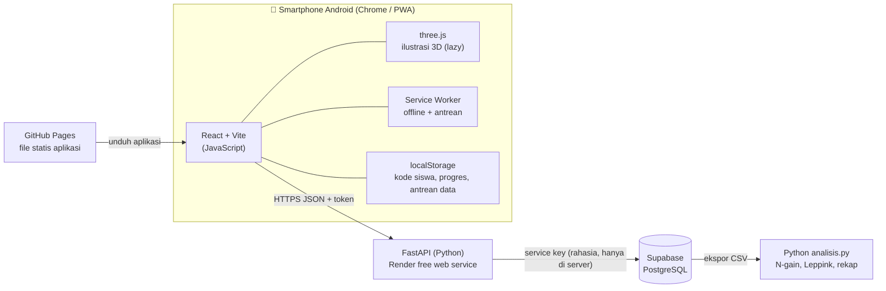
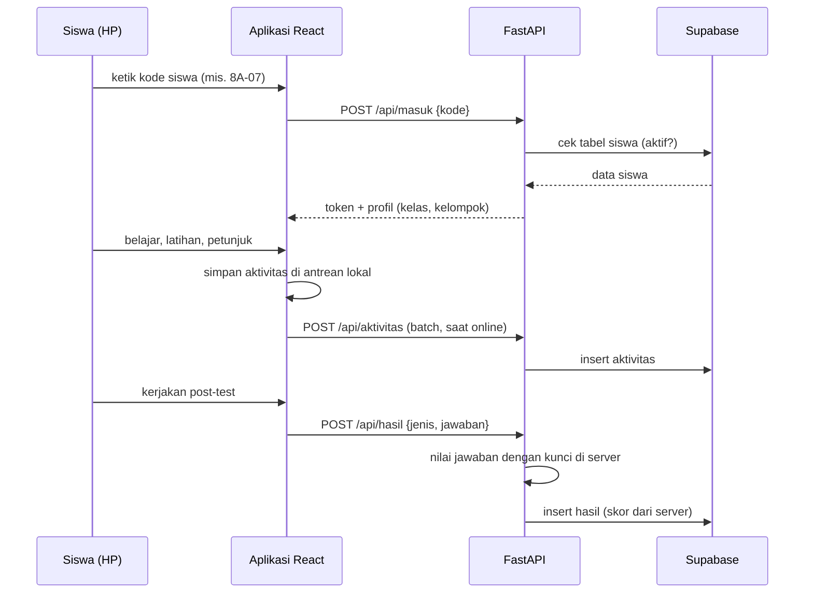

# Arsitektur Aplikasi

> Status: **rancangan v2** (revisi dosen). Bagian "Kondisi sekarang" menjelaskan yang sudah berjalan; bagian "Arsitektur target" menjelaskan arah pengembangan.

## 1. Gambaran besar



| Lapisan | Teknologi | Tugas |
| --- | --- | --- |
| Tampilan | **React 19 + Vite** (JavaScript) | Menu Belajar, Latihan, Tes, Kalkulator; PWA bisa di-install di Android |
| Ilustrasi 3D | **three.js** | Adegan tangga–dinding yang bisa diputar; dimuat hanya saat dibuka |
| Backend | **FastAPI** (Python) di **Render** (gratis) | Masuk dengan kode siswa, menilai tes di server, menyimpan hasil & aktivitas |
| Basis data | **Supabase** (PostgreSQL) | Tabel `siswa`, `hasil`, `aktivitas` |
| Analisis | **Python** (pustaka bawaan) | Rekap pre/post, N-gain, Leppink, jejak belajar |
| Hosting aplikasi | **GitHub Pages** | File statis hasil `npm run build` |

## 2. Alur utama



## 3. Mengapa ada backend Python?
1. **Login kode siswa** divalidasi di server (kode yang tidak terdaftar ditolak), jadi orang asing tidak bisa mengisi data penelitian.
2. **Kunci jawaban & penilaian di server**, sehingga skor tidak bisa diubah dari HP.
3. **Kunci rahasia Supabase** (service role) hanya ada di server; aplikasi di HP tidak memegang kunci apa pun selain alamat API.
4. Memenuhi syarat dosen: **Python + framework** (FastAPI) dan **JavaScript + framework** (React).

## 4. Ketahanan (layanan gratis)
- Render free web service **tidur** setelah ±15 menit tanpa permintaan; permintaan pertama bisa butuh 30–60 detik.
  → Aplikasi **tidak menunggu**: data masuk antrean lokal dan dikirim ulang otomatis; `GET /api/sehat` dipanggil saat aplikasi dibuka untuk "membangunkan" server.
- Supabase gratis dijeda setelah 7 hari tanpa aktivitas → workflow GitHub Actions menyapa database setiap 3 hari (sudah ada).
- Jika backend mati total: aplikasi tetap bisa dipakai belajar; data tersimpan di HP dan bisa diunduh sebagai CSV.

## 5. Struktur folder (target)

```
aplikasi-pythagoras/
├── src/                 frontend React (JavaScript)
│   ├── tiga/            komponen three.js (lazy)
│   ├── api.js           pemanggil backend + antrean offline
│   └── ...
├── backend/             FastAPI (Python)
│   ├── main.py          rute API
│   ├── penilaian.py     kunci & penilaian tes
│   ├── db.py            koneksi Supabase
│   └── requirements.txt
├── supabase/schema.sql  tabel & aturan keamanan
├── analisis/            analisis data (Python)
└── docs/                screenshot, instrumen cetak, bukti AI
```

## 6. Kondisi sekarang → target

| Bagian | Sekarang (sudah berjalan) | Target |
| --- | --- | --- |
| Identitas | Nama + sekolah diketik siswa | **Kode siswa** kelas + absen (`8A-07`) dari tabel `siswa` |
| Simpan data | Aplikasi langsung ke Supabase (kunci publik, insert-only) | Lewat **FastAPI**; Supabase hanya bisa ditulis server |
| Penilaian | Di aplikasi (ikut dicek ulang di `analisis.py`) | Di **server** (FastAPI) |
| 3D | Prisma CSS sederhana | **three.js**: tangga–dinding |
| Animasi | Banyak hiasan | **Tetap** (keputusan pengembang), disembunyikan saat tes |
| Android | PWA (bisa di-install) | PWA dari Chrome (tanpa APK), satu siswa satu HP |

## 7. Keamanan & privasi
- Tidak ada nama asli di basis data; hubungan kode ↔ nama hanya dipegang peneliti (di luar aplikasi).
- Token sesi bertanda tangan (HMAC) berumur 30 hari; tidak ada password.
- CORS backend hanya mengizinkan domain GitHub Pages aplikasi dan `localhost`.
- Rahasia (`SUPABASE_SERVICE_KEY`, `KUNCI_TOKEN`) disimpan sebagai *environment variable* di Render, **tidak** di repositori.
